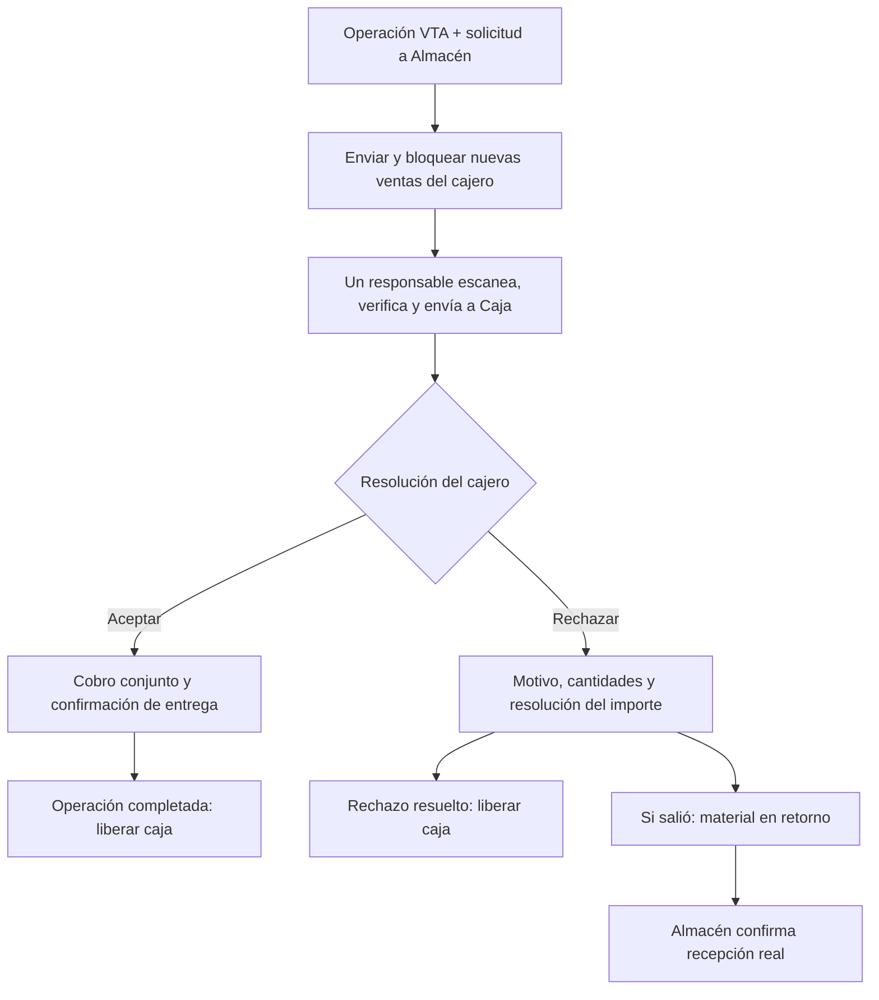

# Caja y Almacén: operación obligatoria hasta completar o rechazar

Fecha: 17 de octubre de 2026 (America/La_Paz).
Estado: implementación local y pruebas completadas; migración y publicación pendientes. Los apartados de revisión inicial conservan la evidencia previa al desarrollo.

## Implementación local del 17 de octubre

- Seller crea la solicitud y su vínculo con la operación en una transacción, sin cobrarla ni abandonar la operación. Vuelve al modo Venta para añadir VTA y cobrar el conjunto.
- Agregar una VTD existente también la vincula. Las históricas ya completadas y sin cobrar conservan su salida previa; no requieren otro despacho.
- El bloqueo persiste en servidor por cajero y turno. Permite generar/cobrar la VTA vinculada y bloquea operaciones ajenas, la desvinculación para evadir el pendiente y el cierre del turno mientras la operación esté abierta.
- El borrador de VTA y sus documentos se recuperan desde el servidor. Sus revisiones detectan cambios de otra pestaña y no sobrescriben silenciosamente el trabajo. El cobro confirmado congela los importes y puede recuperarse sin repetirse.
- En Almacén, las VTD vinculadas usan una pantalla propia: un encargado comprueba todas las cantidades y envía a Caja. Pedidos mayoristas, traslados y VTD no vinculadas conservan sus circuitos anteriores.
- El envío registra una salida del estante a custodia de Caja, con cantidades y Kardex identificados en el expediente. El cierre del cajero registra la entrega definitiva sin descontar stock otra vez.
- Si se omitió el escaneo, Almacén puede regularizar la comprobación con cantidades y motivo, registrando la hora real; no se inventa un escaneo anterior.
- El primer rechazo es completo por VTD. Antes de salir se cancela sin retorno; después de salir queda «Material en retorno a Almacén». Si ya se cobró, se exige registrar una devolución de dinero efectivamente realizada, con referencia, conservando el pago original.
- La VTA aceptada puede cobrarse después de rechazar la VTD. La recepción del retorno queda en Almacén y no bloquea la siguiente operación una vez resuelta la anterior; la entrada de stock sólo se registra al comprobar la recepción completa.
- Los pagos digitales pendientes/rechazados de documentos aceptados impiden completar la entrega; no se acredita un QR por confirmar material. No se implementa un desbloqueo automático por caída del banco.

La migración compartida es `20261017140005_caja_almacen_operacion_unica.sql`, conservada con contenido idéntico en Seller y Almacén. Se aplica **una sola vez** al proyecto compartido, coordinando la publicación de ambas interfaces y la actualización de pestañas antiguas. No se ejecutó en remoto durante este desarrollo.

Validación: 622 pruebas del POS aprobadas (7 omitidas preexistentes), 248 de Almacén tras integrar main, seis recorridos de navegador entre cobro existente y circuito nuevo, integración financiera y pruebas de Kardex real con presentación x12 en PostgreSQL aislado. Compilación de ambos proyectos y ESLint de los archivos de aplicación modificados aprobados. La prueba de navegador del circuito nuevo comprueba que el botón de cobro siga visible a 1280 × 720.

Límites de esta entrega: rechazo parcial por línea, recepción parcial de retornos, reasignación extraordinaria de responsable/turno y resolución gerencial de material ya entregado al cliente sin comprobación quedan para una ampliación. Una diferencia de recepción mantiene el retorno pendiente. No se probaron conexiones PostgreSQL concurrentes independientes ni teléfonos con datos reales. Fotos, NVR y Telegram no forman parte de este cambio.

## Objetivo confirmado por el usuario

El cajero solicita material a Almacén y lo cobra junto con los productos VTA dentro de una misma operación. Un único responsable de Almacén verifica y despacha, con un solo escaneo del QR del documento. La caja de ese cajero permanece bloqueada para nuevas ventas hasta completar o resolver el rechazo de la operación actual. Si se rechaza material que ya salió, debe figurar explícitamente que está regresando a Almacén.

Un solo escaneo del documento no significa omitir la comprobación de productos, presentaciones o cantidades. No se exige un segundo escaneo por otra persona ni en Caja para cerrar la misma entrega.

## Precisión del usuario: la VTA actual sigue habilitada

El usuario aclaró que, cuando una VTD está agregada para cobrarse, los productos VTA forman parte de esa misma operación comercial. El bloqueo impide pasar a otra operación independiente; permite seguir armando y cobrando la VTA vinculada junto con la VTD. No debe bloquear globalmente la creación técnica de un documento VTA, porque el cobro conjunto necesita generarlo.

| Acción mientras la VTD está vinculada a la operación pendiente | Regla |
|---|---|
| Agregar o ajustar productos VTA antes de registrar el cobro | Permitido dentro de la misma operación y con las validaciones habituales. |
| Cobrar el conjunto VTA + VTD | Permitido; conservar documentos y reparto sin cobrar dos veces. |
| Consultar, completar o resolver un rechazo de la operación actual | Permitido. |
| Iniciar otra operación, recuperar otro carrito o cobrar otra venta independiente | Bloqueado hasta resolver la actual. |
| Quitar/desvincular la VTD para cobrar sólo la VTA y eludir el pendiente | No permite liberar la operación; exige resolución trazable. |

Ejemplo: VTA Bs 80 + VTD Bs 120 = cobro conjunto Bs 200. Agregar productos VTA por Bs 20 antes del cobro deja el conjunto en Bs 220 y debe seguir permitido. Iniciar la venta de otro cliente mientras esa operación continúa pendiente queda bloqueado. Después de registrar el cobro, las correcciones usan el procedimiento de ajuste correspondiente; no se editan importes pagados silenciosamente.

El ámbito del bloqueo es la operación activa a la que está vinculada la VTD, con cajero y turno identificados. La existencia de cualquier VTD abierta no debe bloquear indiscriminadamente todas las VTA del cajero. El vínculo y la activación de la restricción deben registrarse de forma atómica; si la solicitud nace desde esta operación, conserva ese vínculo desde su envío. La VTA y la VTD pueden conservar sus documentos propios: «parte de la misma operación» no impone una relación padre/hijo nueva entre las tablas.

## Revisión inicial del código, antes de implementar

Revisión de Seller `cdc4ed0` y Almacén `0bd5b18`. No se consultó la base remota ni se verificó el despliegue de producción en esta sesión.

| Parte | Comportamiento observado | Diferencia con el objetivo |
|---|---|---|
| Cobro conjunto | `CartPanel` suma mostrador, pedido de vendedor y VTD seleccionadas; `PaymentModal` llama `checkoutCaja`; la RPC local `checkout_caja` distribuye el pago y devuelve un comprobante con las ventas vinculadas. | Reutilizar este cobro. Una operación comercial puede contener documentos VTA y VTD distintos; no convertir todo en otra VTA ni duplicar productos. |
| Apertura VTD | `abrirVentaDirecta` crea una VTD, muestra el resultado y llama `clearOperation()`. | Hoy la solicitud puede quedar separada de la operación actual. Debe persistir su vínculo con la caja y la operación bloqueada. |
| Preparación y revisión | `OperacionesMovilApp` y las funciones SQL exigen preparador y verificador distintos. | La regla debe cambiar de forma explícita para este circuito, tanto en interfaz como en servidor. |
| Despacho VTD | La autorización de Almacén llama a `completar_venta`, registra salida de stock y deja la VTD completada. | Hoy completar VTD representa la salida física; no equivale a la futura confirmación final del cajero. |
| Orden de cobro/salida | La autorización VTD exige cobro o pago posterior autorizado. | Si el material se lleva a Caja antes de cobrar, se necesita distinguir ese traslado interno de la entrega definitiva al cliente. |
| Nueva operación | El cobro confirmado y la opción «Dejar retenida» de QR pueden llamar `newOperation()`. Su guarda actual atiende intentos de cobro pendientes en almacenamiento local. | No existe en los puntos revisados una guarda de servidor que abarque toda la operación Caja–Almacén. El bloqueo bancario de QR es otra regla. |
| Rechazo | Existen ajuste y anulación; la descripción de anulación actual contempla devolución de material y dinero. | No reutilizar directamente la anulación para declarar una recepción física que todavía no ocurrió. Falta el retorno pendiente y su recepción real. |

La guía de integración todavía describía cobros separados; el código actual y la migración del 07/10 ya contienen cobro combinado. Esta revisión corrige esa descripción local, sin afirmar que la misma versión esté desplegada.

## Flujo funcional de referencia

1. **Armar la operación.** El cajero agrega productos VTA y el material a solicitar a Almacén. El sistema conserva identificadores de operación, cajero, turno y documentos asociados.
2. **Vincular la VTD y enviar la solicitud cuando corresponda.** Se registra qué VTD pertenece a esta operación y se activa la restricción en servidor de forma atómica. Se bloquea abrir o cobrar otra operación independiente. El cajero puede seguir agregando productos VTA a la operación actual antes del cobro y cobrar el conjunto; enviar la solicitud no deshabilita esa VTA.
3. **Escanear una vez en Almacén.** El único responsable abre el documento, comprueba productos y cantidades y guarda su trabajo. Puede retomarlo desde su bandeja sin otro escaneo obligatorio.
4. **Confirmar el material enviado a Caja.** Se registra responsable, hora y cantidades. Caja recibe el cambio automáticamente. Esa confirmación no acredita dinero ni demuestra entrega al cliente.
5. **Cobrar VTA + material de Almacén.** Se cobra el total conjunto de lo aceptado, conservando la distribución por documento y los cobros ya registrados. Si ya se cobró, se recupera el comprobante en lugar de repetir el pago.
6. **Completar en Caja.** El cajero confirma la entrega al cliente. El servidor verifica que se resolvieron las solicitudes vinculadas y el cobro conforme a las reglas vigentes del medio. Sólo entonces cierra la operación y libera nuevas ventas.
7. **Alternativa: rechazar.** Se registra motivo, cantidades y quién rechaza. Si el material salió, aparece «Material en retorno a Almacén»; si nunca salió, se cancela la solicitud sin inventar retorno ni entrada de inventario. Se recalcula o resuelve el dinero antes de cerrar la operación del cajero.
8. **Recibir el retorno.** Almacén encuentra el retorno en su bandeja y declara lo realmente recibido, con diferencias si las hay. No se exige otro escaneo del QR original. La entrada de stock disponible ocurre únicamente al confirmar la recepción correspondiente.

Para esta propuesta, el cajero puede continuar con otra venta después de resolver comercial y financieramente el rechazo; la recepción física del retorno conserva su responsable y seguimiento en Almacén. Esta separación fue planteada en la conversación y debe quedar visible durante la validación funcional.

## Estados separados

No representar todo con el estado actual `venta.estado`. Los nombres siguientes son funcionales propuestos, no nuevos enums ni contratos SQL ya implementados.

| Eje | Estados orientativos |
|---|---|
| Operación del cajero | Borrador → Activa y bloqueada → Completada / Rechazo resuelto |
| Material de cada solicitud | Solicitado → En revisión → Enviado a Caja → Entregado al cliente; alternativa En retorno → Recibido en Almacén |
| Cobro | Sin cobrar / Registrado por verificar / Confirmado / Ajuste o devolución pendiente / Resuelto |

Registrar QR o transferencia no confirma acreditación bancaria. El nuevo cierre debe respetar las reglas existentes y la decisión que se tome sobre pagos retenidos; no marcar dinero verificado por completar físicamente una entrega.

## Reglas necesarias del bloqueo

- El servidor conserva la operación activa y valida la pertenencia de cada solicitud de venta o cobro a esa operación, incluidas las entradas independientes del carrito. Permite generar/cobrar la VTA vinculada junto con la VTD y rechaza las operaciones ajenas. Deshabilitar «Nueva operación» por sí solo no alcanza; rechazar toda creación de VTA del cajero también sería incorrecto.
- Recargar, cerrar un modal, cambiar de ruta, suspender, limpiar carrito, restaurar un borrador o abrir otra pestaña no elimina el bloqueo ni permite reemplazar la operación activa.
- Un reinicio o nuevo inicio de sesión recupera el pendiente del cajero. El bloqueo no afecta a los demás cajeros que no participan en esa operación.
- Agregar productos VTA antes del cobro, cobrar, consultar y resolver la operación actual siguen habilitados. Las cantidades de Almacén ya enviadas no se editan silenciosamente; los cambios se versionan y se vuelven a comprobar cuando corresponda.
- Completar, rechazar, registrar cobro y recibir retorno admiten reintento sin duplicar pagos ni movimientos de stock. Dos pestañas no pueden completar y rechazar simultáneamente el mismo estado.
- El QR identifica el documento; la autorización sigue dependiendo del usuario, su sucursal y el estado vigente.
- El cierre y la liberación del bloqueo se confirman juntos en servidor. Una respuesta perdida se recupera consultando el resultado de la misma operación.
- El cierre de turno no debe dejar huérfana una operación nueva bloqueada. Debe resolverse o transferirse por un procedimiento autorizado todavía por definir.

## Stock y dinero: alternativas planteadas en la revisión inicial

La salida previa de VTD se registraba en `completar_venta`. La revisión consideró reserva o tránsito explícito para «enviado a Caja». La implementación local descrita arriba registra salida a custodia de Caja con Kardex y cantidades en el expediente, sin repetirla al completar; el material separado queda fuera del disponible y sólo vuelve con recepción real.

Si se rechaza una parte de Almacén, las líneas VTA que el cliente conserva permanecen en la operación. Sin cobro previo se ajusta el importe a cobrar; con cobro previo se conserva el pago y se tramita su ajuste/devolución/saldo conforme al mecanismo autorizado. Un clic de rechazo no ejecuta una transferencia bancaria ni certifica una devolución de dinero.

El nombre «rechazar» de esta nueva entrega no debe confundirse con «devolver preparación para corregir» de Almacén, rechazo de un pago digital o rechazo de líneas de un pedido mayorista.

## Alcance original y seguimiento de las decisiones

Confirmado: cobro conjunto VTA + solicitud a Almacén, un verificador/despachador, un escaneo del documento y bloqueo del cajero hasta resolver la operación; rechazo con retorno visible cuando corresponda.

Puntos planteados antes del desarrollo (ver implementación y límites arriba para su estado vigente):

- Modelo de reserva/tránsito y momento exacto de salida definitiva de inventario.
- Si el piloto permite rechazo parcial por línea o sólo rechazo completo de la entrega de Almacén. El rechazo completo inicial fue una propuesta del asistente, no una exigencia del usuario.
- Reglas para pagos QR retenidos y excepciones de pago posterior; no asumir que «Dejar retenida» puede liberar una operación con entrega pendiente.
- Reasignación por ausencia del cajero, incidentes de conexión y cierre de turno: roles, motivos y responsabilidad. No incorporar un desbloqueo genérico sin trazabilidad.
- Alcance sobre pedidos mayoristas, entregas parciales y traslados independientes. No extender automáticamente este bloqueo ni el cambio de verificador a esos circuitos.
- Compatibilidad con VTD históricas ya cobradas pero sin despachar. La corrección de cierre de turno del 15/10 no queda revertida por esta nota; las operaciones nuevas requieren identidad y reglas propias.

Fotos y NVR podrán enlazarse a los eventos de envío, rechazo y recepción, con la identidad de cada entrega. Esta revisión no los implementa ni los vuelve requisito de cierre.

## Comprobaciones para la implementación futura

- VTA + VTD se cobran juntas una sola vez; VTD ya pagada no se cobra otra vez.
- Con VTD pendiente vinculada, agregar/ajustar productos VTA antes del cobro y generar su documento dentro del checkout conjunto sigue funcionando; intentar otra operación falla. Probar ambas acciones con el mismo cajero para evitar un bloqueo global accidental.
- Desvincular la VTD, limpiar el carrito o usar una ruta alternativa de cobro no convierte el pendiente en una venta independiente ni libera la restricción sin resolución.
- El único encargado puede verificar y despachar con un escaneo de documento; retomar la tarea no exige otro usuario.
- Una operación pendiente bloquea otra venta por interfaz y servidor, incluidas pestañas paralelas y rutas alternativas; otro cajero puede seguir trabajando.
- Cobro resuelto sin confirmación física y confirmación física sin cobro resuelto no liberan la operación indebidamente.
- Rechazo antes de salida no genera retorno ficticio; rechazo después de salida no repone stock antes de recepción.
- Un rechazo conserva la VTA aceptada y resuelve correctamente pagos previos, descuentos y reparto entre documentos.
- Recepción incompleta deja diferencia e incidencia; reintentos no duplican entrada de inventario.
- Reinicio, respuesta perdida y completar/rechazar concurrentes recuperan un único resultado coherente.
- Se preservan reglas vigentes de verificación bancaria y el tratamiento de VTD históricas.

## Fuentes locales revisadas

- Seller: `src/components/CartPanel.tsx`, `src/components/PaymentModal.tsx`, `src/context/PosContext.tsx`, `src/components/PosHeader.tsx`.
- Seller: `src/infrastructure/supabase/CajaCheckout.supabase.ts`, `src/infrastructure/supabase/VentaDirectaRepository.supabase.ts`, `src/features/venta-directa/VentaDirectaPage.tsx`, `src/features/cash/CashPage.tsx`.
- Seller: `supabase/migrations/20261007213559_checkout_caja_unificado.sql` y `docs/vtd-revision-despacho-cobro-2026-10-13.md`.
- Almacén: `src/OperacionesMovilApp.jsx`, `src/lib/operacionesMovil.js`, `src/lib/operaciones.js`.
- Almacén: `supabase/migrations/20261012195525_flujos_qr_vtd_traslado_virtual.sql` y `supabase/migrations/20261013143239_fix_cierre_revision_cobro_vtd_pedidos.sql`.

Alcance de la revisión inicial: lectura de código y documentación. Posteriormente se implementó y probó el circuito local descrito al principio de esta nota. No se modificó la base compartida, no se publicaron las interfaces y no se ejecutaron ventas o devoluciones reales.
